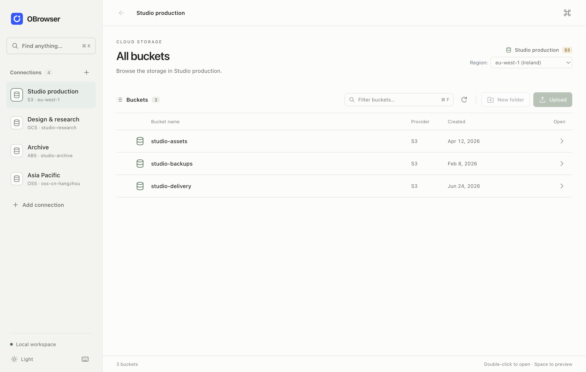
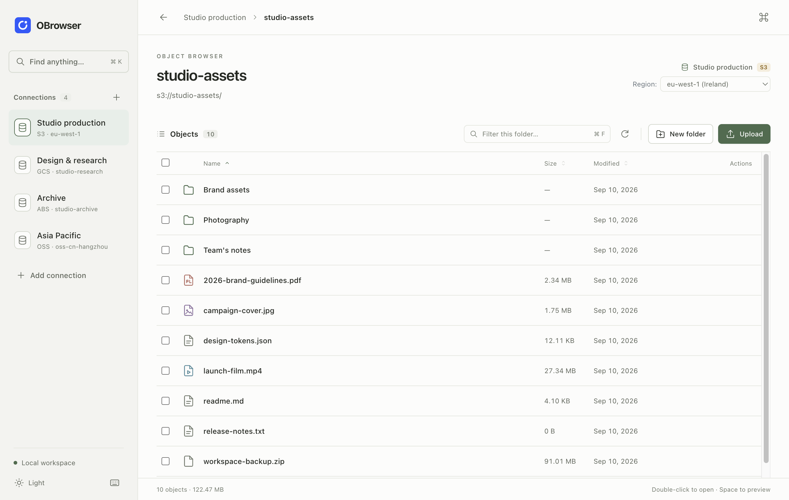
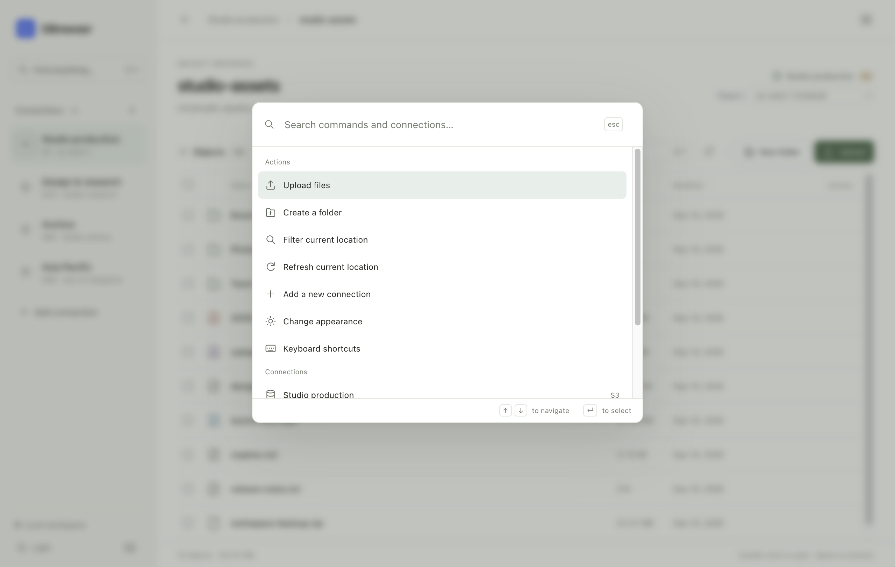
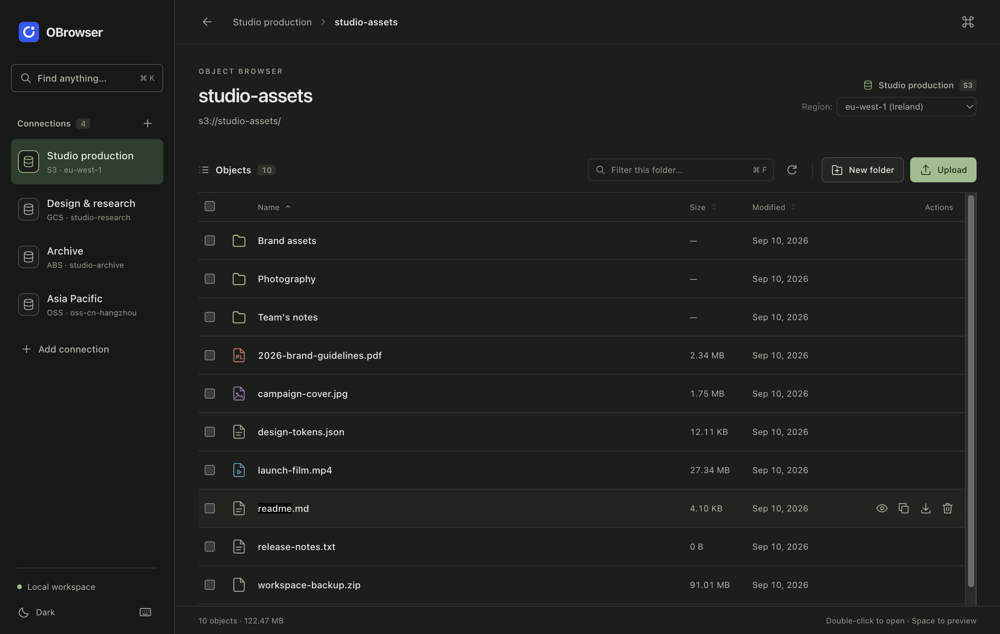
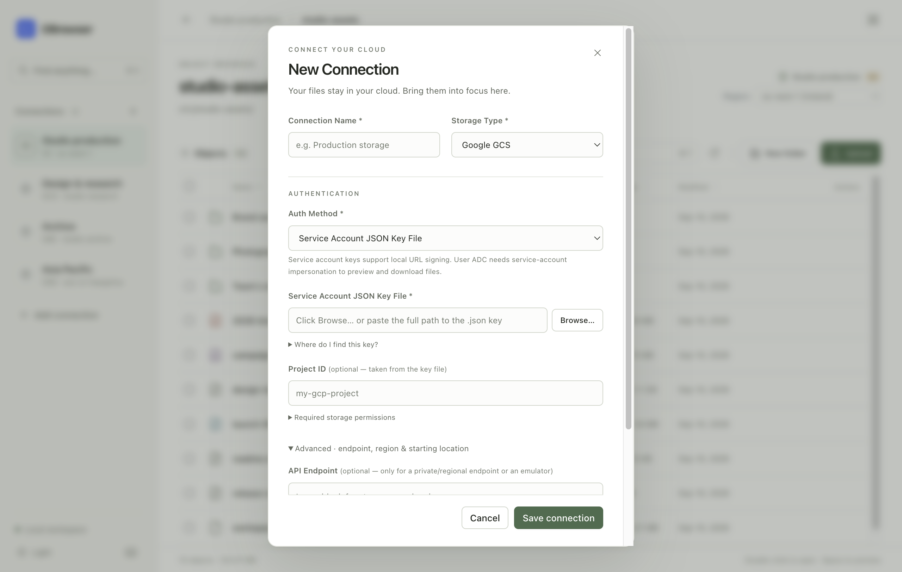

# Multi-Cloud Object Storage Browser

Cross-platform desktop application for browsing and managing files across multiple cloud object storage services.

## Interface

A quiet, keyboard-friendly workspace with light, dark, and system appearance.
Single-click to select, double-click to open, and `Cmd/Ctrl K` for commands.

All screenshots below use synthetic demo data, never a real account.

### Four clouds, one sidebar



S3, GCS, Azure Blob and Aliyun OSS sit side by side; switching is a single click.
The bucket list carries the provider and creation date, and an S3 connection's
region can be changed from the header without reopening the connection.

### The object list is the same everywhere



`Cmd/Ctrl F` filters the current folder, Space previews the focused row, and
double-click enters a folder. Sort by name, size or modified date; select several
rows to download or delete them in one go. Filtering deselects hidden rows, so a
bulk delete cannot reach an object you cannot see.

### Cmd/Ctrl K goes anywhere



The palette lists both actions and every saved connection, so moving from a
folder in one cloud to a bucket in another is two keystrokes rather than four
clicks. Only currently available actions are offered.

### Dark mode is a full theme



Not a dimmed background. Switch it bottom-left or search for "appearance" in the
command palette; light, dark and follow-system are stored locally.

### Credentials are asked for the way each cloud issues them



GCS asks for a service account JSON key file or ADC, S3 takes access keys, STS
session tokens or a local AWS profile, Azure wants an account name and key, OSS
an AccessKey pair. Endpoint, region and starting location are tucked under
Advanced, so the common case stays short. Because the endpoint is a text field
rather than a fixed list, S3-compatible services such as MinIO and Cloudflare R2
connect as S3.

See the [UI design notes and previews](docs/ui-design.md) for the design references, interaction model, and verification steps.

## Supported Cloud Storage Services

- **AWS S3**: Amazon Simple Storage Service
- **Azure Blob Storage**: Microsoft Azure's object storage solution
- **Aliyun OSS**: Alibaba Cloud Object Storage Service
- **Google Cloud Storage**: via the native JSON API, authenticated with a service account JSON key file or Application Default Credentials

## Features

- Browse buckets/containers and objects across multiple cloud providers
- Upload and download files
- Create folders
- Delete files and folders
- Preview text files, images, PDFs, and more
- Generate temporary signed URLs for file access
- Manage multiple storage accounts
- Cross-platform (Windows, macOS, Linux)

## Installation

### Prerequisites

- **Node.js 18+ and npm.** Electron 28 bundles its own Node 18 at runtime, so the
  system version only matters for building and testing.
- **macOS release builds** additionally need Xcode command line tools (for
  `codesign`, `iconutil` and `notarytool`) and an Apple Developer Program
  membership. See [Signing and notarization](#signing-and-notarization).

### Building from Source

1. Clone the repository
```bash
git clone https://github.com/zhuermu/obrowser.git
cd obrowser
```

2. Install dependencies
```bash
npm install
```

npm 11 does not run dependency install scripts unless they are approved, and
Electron downloads its binary from one. If `npm start` then fails with a missing
Electron executable, approve it and reinstall:

```bash
npm install-scripts approve electron
npm install
```

3. Start the application in development mode
```bash
npm start
```

4. Build for your platform
```bash
npm run build:mac          # dmg + zip, x64 and arm64; signs and notarizes
npm run build:mac:no-notarize   # same without notarization, for local testing
npm run build:win          # portable + zip, x64
npm run build:linux        # AppImage, x64
```

Artifacts are written to `dist/`.

Cross-building has limits worth knowing before you try: from macOS the Windows
`zip` target works, but `portable` is NSIS-based and needs Wine. AppImage
likewise expects Linux tooling or a container. Build each platform on that
platform, or in CI, when you need the installer formats.

### Signing and notarization

macOS builds are signed with a Developer ID certificate and notarized by Apple,
because since Catalina an app downloaded from a website is blocked by Gatekeeper
unless it is notarized — a Developer ID signature alone is not enough.

`package.json` already sets `mac.identity`, `hardenedRuntime`, the entitlements
and `mac.notarize.teamId`. What is not in the repository is the credential:

```bash
cp .env.example .env
# APPLE_ID=your-apple-id@example.com
# APPLE_APP_SPECIFIC_PASSWORD=xxxx-xxxx-xxxx-xxxx   (appleid.apple.com)
```

`.env` is gitignored. `npm run build:mac` loads it; each architecture takes
roughly five minutes end to end, of which notarization is two to four.

If `notarytool` returns `403 A required agreement is missing or has expired`, the
credentials are fine — the Account Holder has to accept the updated Apple
Developer Program License Agreement at developer.apple.com/account. It takes a
few minutes to propagate afterwards.

Verify a finished build with:

```bash
spctl -a -vvv -t install "dist/mac-arm64/OBrowser.app"   # expect: accepted, source=Notarized Developer ID
xcrun stapler validate "dist/mac-arm64/OBrowser.app"     # expect: The validate action worked
```

### App icons

`obrowser.icns`, `obrowser.ico` and `obrowser.png` are generated from the brand
SVGs in `OBrowser_Logo_v1/`:

```bash
npm run icons
```

### Tests

```bash
npm test          # unit and integration suites
npm run test:ui   # isolated Electron interaction tests and screenshots
```

Azure and GCS have end-to-end suites that run against emulators and skip
themselves when none is listening, so `npm test` stays green without them. To
include them:

```bash
npm run emulator:azure   # Azurite on 127.0.0.1:10000
npm run emulator:gcs     # fake-gcs-server on 127.0.0.1:4443, needs Docker
```

## Usage

### Adding a Connection

1. Click "Add Connection" in the sidebar
2. Select the storage type
3. Enter the connection details:
   - **Connection Name**: A user-friendly name for the connection
   - **Storage Type**: AWS S3, Azure Blob, Aliyun OSS, or Google Cloud Storage
   - **Endpoint**: The service endpoint URL
   - **Region**: The service region
   - **Authentication Details**: Credentials required for the selected storage type
   - **Bucket/Container** (Optional): Default bucket/container to open on connection
   - **Prefix Path** (Optional): Default folder path to navigate to

### Authentication Details by Provider

#### AWS S3
- **Access Key**: AWS access key ID
- **Secret Key**: AWS secret access key

#### Azure Blob Storage
- **Account Name**: Azure storage account name
- **Account Key**: Azure storage account key

#### Aliyun OSS
- **Access Key**: Aliyun access key ID
- **Secret Key**: Aliyun access key secret

#### Google Cloud Storage
Google's primary credential is a single JSON key file, not an access-key/secret pair.

- **Auth Method**: `Service Account JSON Key File` or `Application Default Credentials`
- **Service Account JSON Key File**: path to a key created under IAM & Admin → Service Accounts → Keys → Add key → JSON. Only the path is stored in the connection profile; the private key stays in the file on disk.
- **Project ID** (optional): defaults to the project in the key file
- **API Endpoint** (optional): only for a private/regional endpoint or an emulator

Required roles: `Storage Object Viewer` to browse and download, `Storage Object Admin` to upload, create folders, or delete. Listing buckets additionally needs `storage.buckets.list` (e.g. `Storage Admin` at the project level).

For Application Default Credentials, run `gcloud auth application-default login` first. Note that user-account ADC has no private key, so signed URLs (used for preview and download) fall back to the IAM SignBlob API and need the `iam.serviceAccounts.signBlob` permission — a service account key avoids that.

If you specifically want an access-key/secret pair for GCS, those are "HMAC keys" for the S3-compatible XML API, created under Cloud Storage → Settings → Interoperability. GCP **API keys** (`AIza…`) cannot be used: they identify no principal, so IAM cannot authorize them for private buckets.

### File Operations

- **Browse Folders**: Double-click folders to navigate in and out of directories
- **Upload Files**: Select files from your computer to upload to the current folder
- **Download Files**: Select files and click the download button
- **Create Folders**: Create new folders in the current directory
- **Delete Files/Folders**: Select items and click the delete button
- **Preview Files**: Double-click a file, press Space on its focused row, or use its preview button.
- **Select Files**: Click to select, Shift-click for a range, or Cmd/Ctrl-click to add to a selection.
- **Filter**: Cmd/Ctrl+F filters the current location. It does not search across buckets.
- **Commands**: Cmd/Ctrl+K finds available actions and saved connections.

### UI Verification

Run `npm run test:ui` for isolated Electron interaction tests and screenshots. This uses synthetic in-memory storage and a temporary profile, never your real saved connections. Run `npm run test:ui -- --update-screenshots` to regenerate the checked-in design previews.

## Extending for Additional Storage Providers

The application is designed with extensibility in mind. To add support for additional storage providers:

1. Create a new client implementation in the `storage-clients` directory
2. Extend the `StorageClientInterface` class to implement required methods
3. Register the new client type in the `StorageClientFactory`
4. Update the UI to include the new storage type


## License

MIT

## Contributors

- List your contributors here
