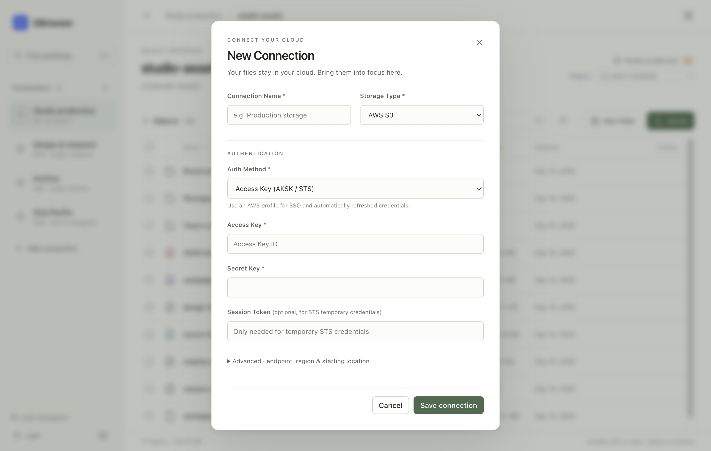

# OBrowser · Quiet Workspace

这次升级的主参考是 **Linear 的桌面应用设计**。这里的“有品味”不是客观排名，而是更适合对象存储工具的取舍：减少视觉噪音，让层级、对齐和直接操作成为界面的主体。

## 设计参考

- [Linear — How we redesigned the Linear UI](https://linear.app/now/how-we-redesigned-the-linear-ui)：参考其应用外框、侧栏与内容的清晰分层，以及中性底色、细边界和克制的强调色。采用的是产品界面原则，不是营销网站的装饰效果。
- [Raycast](https://www.raycast.com/)：参考其 keyboard-first 原则、可搜索命令和就地执行操作。OBrowser 的命令菜单只列出当前可执行的动作和实际保存的连接。
- Finder 的既有桌面操作习惯：单击选中、双击打开、Shift 范围选择，以及路径逐级返回。保留原生窗口控件和菜单。

查阅日期：2026-09-14。没有将“社区热门”当成经过统计的排名；外部参考是方向判断，具体布局按 OBrowser 的真实任务设计。

## 第一性原理

用户主要需要回答三个问题：**在哪个云？在哪个路径？要对哪些对象做什么？**

因此信息按任务顺序组织：

1. 左侧只管理连接，始终显示连接名称和存储类型。
2. 上方明确显示路径、当前目录和连接；S3 区域切换仍然可见。
3. 主区域优先给文件名、大小和日期。宽窗口显示类型与存储级别；窄窗口通过文件名悬停仍可查看完整元数据。
4. 批量下载和删除只在选中对象时出现。过滤会取消隐藏对象的选择，避免误删不可见文件。
5. 操作按钮出现在悬停、键盘焦点和选中状态中。功能入口保留可访问名称。

## 视觉系统

- 暖灰背景、纸白内容、低饱和鼠尾草绿强调色；沿用仓库的应用品牌图标。
- 深色 / 浅色 / 跟随系统三种外观，偏好保存在本机。
- 系统字体、本地 SVG 线性图标，无远程字体或图标 CDN。
- 同一套语义色彩、圆角、控件和布局变量覆盖列表、表单、预览、命令菜单与提示。
- 最小窗口 980 × 640；表单可滚动、操作区固定可达，文件表头随列表滚动保持可见。

## 交互

- `Cmd/Ctrl K`：搜索命令和连接。
- `Cmd/Ctrl F`：过滤当前目录，不伪装成全桶或跨云搜索。
- `Cmd/Ctrl A`：选择当前可见对象。
- 单击 / `Shift` 单击 / `Cmd/Ctrl` 单击：单选、范围选择、多选。
- 双击 / 聚焦行后 `Enter` 或 `Space`：打开目录或预览文件。
- `Alt ←`：返回上一级，保留连接的 bucket 限定。
- `Esc`：关闭弹窗或清空选择。
- 连接表单以名称、云服务和认证为主，高级网络与起始位置设置折叠；OSS 因需要 endpoint 或 region 会自动展开。
- 文件列表排序在本地完成，不额外发起云端请求。
- 空目录、没有搜索结果和访问失败分别提供适合当前情况的下一步。

## 实现与验证

界面拆分为 `ui.css`、`ui-icons.js`、`workspace-ui.js`，存储操作仍由 `renderer.js` 与既有客户端负责。没有引入新的运行时依赖。

同时修复了界面测试暴露出的 S3 可选 endpoint 校验矛盾和批量下载引用不存在的 `getSelectedItems()`。异步列表采用请求代次检查，避免旧连接的慢请求覆盖新连接；批量删除捕获确认时的对象与位置。

```sh
npm start
npm test -- --runInBand --silent
npm run test:ui
# 明确更新下方的演示截图
npm run test:ui -- --update-screenshots
```

Electron UI 测试使用独立临时 profile、内存连接和虚构文件，不读取实际连接、不访问云端、不产生真实下载。覆盖选择、过滤、排序、导航、认证切换、保存、建目录、删除确认、下载 URL 校验、预览、竞态和三种窗口尺寸。真实云读写及签名安装包不包含在这次 UI 验证中；需要本地模拟器的既有用例可能跳过。

## 预览

以下均为运行真实界面代码、使用虚构存储数据生成的截图。




